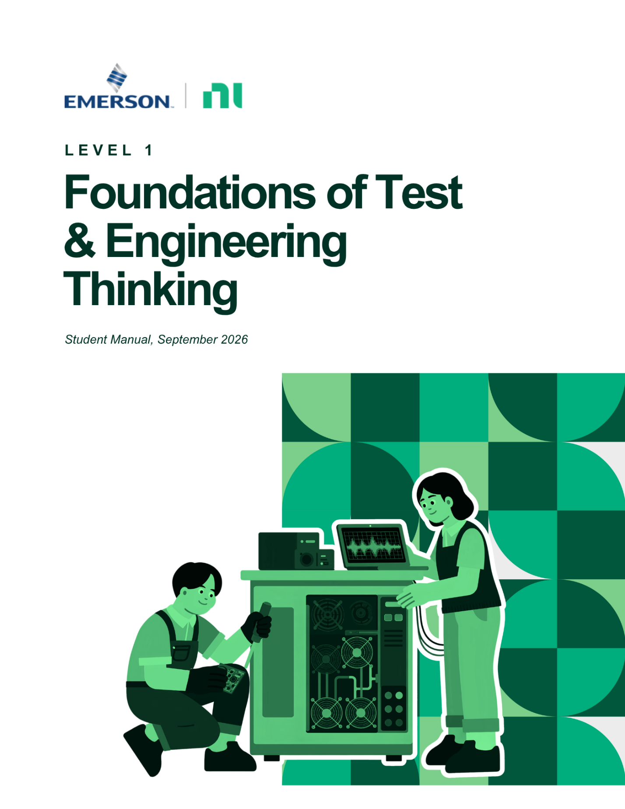
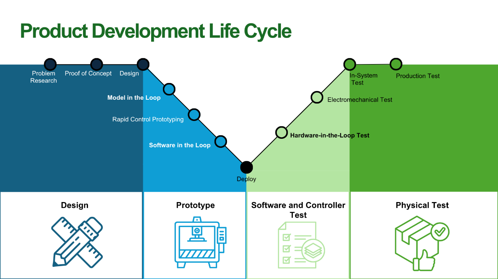
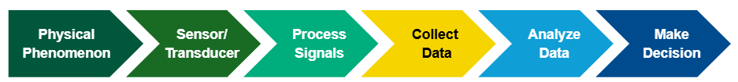
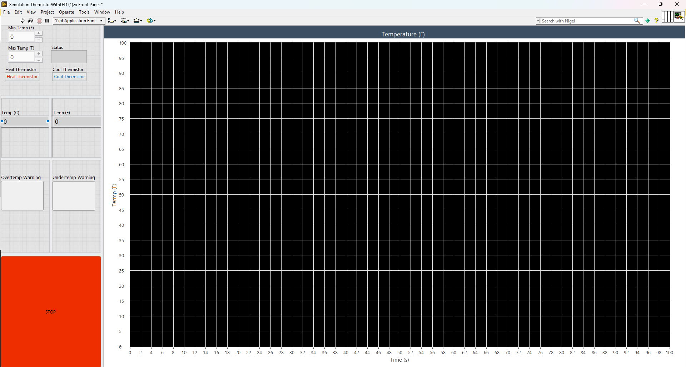
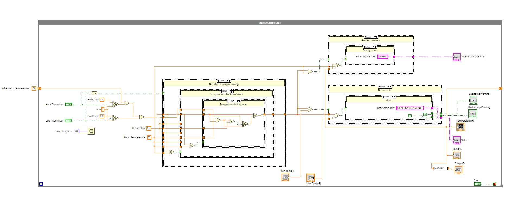

Level 1: Foundations of Test & Engineering Thinking
===================================================

.. contents:: On This Page
   :local:
   :depth: 2

About This Workshop
-------------------

Level 1 introduces the foundations of test engineering through a
greenhouse temperature-monitoring challenge.

This online version of the workshop uses software simulations. Instead
of connecting a physical thermistor and LEDs to measurement hardware,
you will interact with a simulated thermistor, collect simulated
temperature data, analyze the results, and observe how the system
responds.

You will complete the simulation first in LabVIEW and then in Python.

Both simulations follow the same engineering workflow used during the
in-person workshop:

**Physical Phenomenon → Sensor → Acquisition → Analysis → Decision → Action**

.. note::

   During the in-person workshop, students use a physical thermistor,
   warning LEDs, a breadboard, and an NI mioDAQ.

   In this online workshop, LabVIEW and Python generate the temperature
   measurements and simulate the warning indicators.

   The source of the data is different, but the engineering process is
   the same.

Learning Objectives
-------------------

By the end of this workshop, you should be able to:

- Explain why engineers test products and systems.
- Describe the role of testing throughout product development.
- Identify the steps of the measurement chain.
- Use LabVIEW and Python to run a simulated measurement system.
- Compare measurements against engineering requirements.
- Use measurement data to make a decision.
- Explain how the simulation relates to a physical test system.

Test in Engineering
-------------------

Every day, we interact with products that we rarely think twice about.

- You expect your phone to connect to Wi-Fi.
- You expect your car to start.
- You expect your headphones to connect to Bluetooth.
- You expect the elevator to stop at the correct floor.
- You expect your GPS to tell you where you are.

But how do we know these systems will work?

The answer is testing.

What Is Test?
^^^^^^^^^^^^^

Test in engineering is the process of evaluating the performance,
reliability, safety, and quality of a product before it reaches the
customer.

Engineers design experiments, collect data, and build automated systems
that help answer one of the most important questions in engineering:

**How do we know this works?**

Rather than relying on assumptions, engineers use measurements and data
to verify that a product behaves as expected.

Testing provides evidence that helps answer questions such as:

- Does the product work?
- How well does it work?
- What happens if it fails?
- Does it meet its requirements?
- How can it be improved?

Hardware and Software Test
^^^^^^^^^^^^^^^^^^^^^^^^^^

Testing exists in many forms, but it can look different depending on
what is being tested.

+------------------------------------+------------------------------------+
| Hardware Testing                   | Software Testing                   |
+====================================+====================================+
| Tests physical products            | Tests software and applications    |
+------------------------------------+------------------------------------+
| Uses sensors, instruments, code,   | Uses code and test scripts         |
| and test systems                   |                                    |
+------------------------------------+------------------------------------+
| Focuses on physical performance,   | Focuses on functionality and user  |
| quality, and reliability           | experience                         |
+------------------------------------+------------------------------------+
| Example: Medical device            | Example: Mobile application        |
+------------------------------------+------------------------------------+

This workshop focuses on hardware-test principles. However, the online
activity uses software to simulate the behavior of a physical
measurement system.

The Product Life Cycle
----------------------

What Is It?
^^^^^^^^^^^

The Product Life Cycle is the journey a product takes from an initial
idea to something customers use in the real world.

For engineers, the lifecycle commonly includes:

- Research
- Design
- Prototyping
- Verification and validation
- Production
- Deployment
- Continued improvement

   Figure 1. Product Development Life Cycle.

Testing does not happen only after a product is finished.

Engineers test ideas during research, verify design assumptions,
evaluate prototypes, inspect products during manufacturing, and monitor
performance after deployment.

Two especially important phases are:

- **Verification and Validation**, or V&V
- **Production**

**Verification and Validation asks:**

   Did we design the product correctly?

**Production testing asks:**

   Did we build the product correctly?

Verification and Validation Testing
^^^^^^^^^^^^^^^^^^^^^^^^^^^^^^^^^^^

Before a company manufactures thousands or millions of products,
engineers need confidence that the design will perform as expected.

V&V testing is performed on prototypes and early product designs to
evaluate functionality, performance, reliability, safety, and other
requirements.

+-------------------+--------------------------------------------------+
| Type of Test      | Questions It Answers                             |
+===================+==================================================+
| Functional        | Does the product do what it was designed to do?  |
+-------------------+--------------------------------------------------+
| Performance       | How well does the product perform?               |
+-------------------+--------------------------------------------------+
| Reliability       | Will it continue working over time?              |
+-------------------+--------------------------------------------------+
| Environmental     | Can it survive where it will be used?            |
+-------------------+--------------------------------------------------+
| Stress            | What happens outside normal conditions?          |
+-------------------+--------------------------------------------------+
| Safety            | Does the product operate safely?                 |
+-------------------+--------------------------------------------------+

Production Testing
^^^^^^^^^^^^^^^^^^

Once engineers have confidence in the design, the next challenge is
manufacturing products consistently.

Production testing occurs during manufacturing and helps ensure that
each unit meets its quality and performance requirements.

Unlike V&V, which focuses on learning about and proving the design,
production testing focuses on:

- Speed
- Repeatability
- Quality
- Consistency
- Pass/fail decisions

V&V Versus Production
^^^^^^^^^^^^^^^^^^^^^

+--------------------------------+--------------------------------------+
| Verification and Validation    | Production                           |
+================================+======================================+
| Proves the design works        | Proves each manufactured unit works  |
+--------------------------------+--------------------------------------+
| Focuses on prototypes          | Focuses on finished products         |
+--------------------------------+--------------------------------------+
| Finds design issues            | Finds manufacturing issues           |
+--------------------------------+--------------------------------------+
| Emphasizes learning            | Emphasizes quality and consistency    |
+--------------------------------+--------------------------------------+
| “Did we design it correctly?”  | “Did we build it correctly?”         |
+--------------------------------+--------------------------------------+

Why Testing Matters
-------------------

When someone buys a product, they trust that it will perform as
expected.

Testing helps engineers build that trust by identifying problems before
customers encounter them. Without testing, companies risk safety
failures, recalls, expensive redesigns, and inconsistent products.

At its core, testing reduces uncertainty.

It transforms:

**We think it works.**

into:

**We have evidence that it works.**

Good testing requires engineers to:

- Ask clear questions
- Define requirements
- Collect reliable measurements
- Analyze data
- Compare results against expectations
- Make evidence-based decisions

Engineering Skills
^^^^^^^^^^^^^^^^^^

Throughout this program, you will practice:

- Defining engineering problems
- Working with sensors and measurements
- Acquiring and analyzing data
- Using evidence to make decisions
- Troubleshooting systems
- Communicating technical ideas
- Applying engineering concepts to real-world scenarios

These skills are used in many engineering roles, including:

- Test Engineer
- Validation Engineer
- Automation Engineer
- Systems Engineer
- Controls Engineer
- Manufacturing Engineer
- Design Engineer

The Measurement Chain
---------------------

Engineering decisions begin with information from the physical world.

The process of turning a real-world condition into useful information
is called the **measurement chain**.

The measurement chain used in this workshop is:

**Physical Phenomenon → Sensor → Acquisition → Analysis → Decision → Action**

In the in-person workshop, a thermistor responds to temperature and the
mioDAQ acquires an electrical signal from the thermistor circuit.

In this online workshop, software simulates the temperature and sensor
response.

The measurements are simulated, but the analysis, decision logic,
indicators, and engineering thought process remain the same.

Simulated Greenhouse Challenge
------------------------------

Project Scenario
^^^^^^^^^^^^^^^^

Imagine you work for a climate-control company that supports commercial
greenhouses.

Your customer needs a temperature-monitoring system that helps protect
crops from extreme temperatures.

Your job is to evaluate a simulated system that monitors temperature
and warns operators when conditions move outside an acceptable range.

The system must:

- Continuously monitor greenhouse temperature.
- Maintain a target range of 70°F to 85°F.
- Turn on a blue indicator below 70°F.
- Turn on a red indicator above 85°F.
- Display the current system status.
- Provide a clear warning when conditions are unsafe.

In-Person and Online Experiences
^^^^^^^^^^^^^^^^^^^^^^^^^^^^^^^^

Both versions follow the same measurement chain, but they generate and
acquire data differently.

+----------------------+------------------------------+------------------------------+
| Step                 | In-Person Workshop           | Online Workshop              |
+======================+==============================+==============================+
| Physical phenomenon  | Real temperature             | Simulated temperature        |
+----------------------+------------------------------+------------------------------+
| Sensor               | Physical thermistor          | Simulated thermistor         |
+----------------------+------------------------------+------------------------------+
| Signal               | Electrical voltage           | Software-generated value     |
+----------------------+------------------------------+------------------------------+
| Acquisition          | NI mioDAQ                    | LabVIEW or Python loop       |
+----------------------+------------------------------+------------------------------+
| Analysis             | Convert and compare data     | Compare simulated data       |
+----------------------+------------------------------+------------------------------+
| Decision             | Hot, cold, or acceptable     | Hot, cold, or acceptable     |
+----------------------+------------------------------+------------------------------+
| Action               | Physical warning LEDs        | Simulated indicators         |
+----------------------+------------------------------+------------------------------+

.. important::

   A simulation helps us study the behavior and logic of a measurement
   system, but it does not replace every aspect of working with physical
   hardware.

   Real measurements can be affected by sensor accuracy, electrical
   noise, wiring, signal conditioning, input range, grounding, and the
   physical environment.

Physical Phenomenon
^^^^^^^^^^^^^^^^^^^

A physical phenomenon is something happening in the real world that we
want to observe or measure.

Examples include:

- Temperature
- Pressure
- Force
- Motion
- Light
- Sound

For this project, the physical phenomenon is greenhouse temperature.

In the in-person workshop, the temperature surrounding a physical
thermistor changes.

In the simulation, software creates a changing temperature value that
represents conditions inside the greenhouse.

**Think About It**

- What could happen if a greenhouse becomes too hot?
- What could happen if it becomes too cold?
- Why would operators need a warning system?

Sensor
^^^^^^

A sensor detects a physical phenomenon and converts it into a signal
that a measurement system can use.

The in-person workshop uses a thermistor. A thermistor changes
resistance as its temperature changes.

The online simulations represent the thermistor in software.

Using the Heat Thermistor or Cool Thermistor control changes the
simulated temperature that would normally be influenced by the physical
sensor and its environment.

Signal Conditioning
^^^^^^^^^^^^^^^^^^^

Signal conditioning prepares a sensor signal so it can be measured
accurately and safely.

A physical thermistor does not directly produce a temperature value that
a computer can understand. It changes resistance.

A circuit and measurement device convert that changing resistance into
a measurable voltage.

Signal conditioning can help:

- Reduce noise
- Amplify small signals
- Provide sensor excitation
- Protect measurement equipment
- Match the signal to the DAQ input
- Address nonlinear sensor behavior
- Improve measurement quality

In the simulations, we do not physically condition an electrical
signal. The programs directly generate simulated temperature values.

This allows us to focus on the rest of the measurement chain.

However, it is important to remember that a physical measurement system
must account for the electrical behavior of the sensor.

Acquisition
^^^^^^^^^^^

Acquisition is the step where a system collects measurements and makes
the data available to a computer.

During the in-person workshop, the mioDAQ acquires voltage from the
thermistor circuit.

During the online workshop, a timed software loop generates and records
new temperature values.

The simulations begin at a temperature near 70°F.

- Using Heat Thermistor increases the simulated temperature.
- Using Cool Thermistor decreases the simulated temperature.
- Releasing the controls allows the temperature to move back toward the
  simulated room temperature.

Although the source is different, the programs still collect a sequence
of measurements over time.

Analysis
^^^^^^^^

Analysis is the step where data becomes useful information.

The simulations compare the current temperature against the greenhouse
requirements:

- Below 70°F means the greenhouse is too cold.
- From 70°F through 85°F means the greenhouse is in the ideal range.
- Above 85°F means the greenhouse is overheating.

The simulations also show how the temperature changes over time.

Decision and Action
^^^^^^^^^^^^^^^^^^^

The simulated systems use the following logic:

+-------------------------+----------------+---------------------------+
| Condition               | System Status  | Action                    |
+=========================+================+===========================+
| Temperature below 70°F  | TOO COLD       | Blue indicator turns on  |
+-------------------------+----------------+---------------------------+
| Temperature from        | IDEAL          | Both indicators remain   |
| 70°F through 85°F       |                | off                       |
+-------------------------+----------------+---------------------------+
| Temperature above 85°F  | OVERHEATING    | Red indicator turns on   |
+-------------------------+----------------+---------------------------+

In a real greenhouse, the final action could activate a fan, heater,
alarm, or ventilation system.

In these simulations, the red and blue indicators communicate the
decision without controlling physical equipment.

Software Setup
--------------

You will complete the greenhouse simulation twice:

1. First in LabVIEW
2. Then in Python

Both programs simulate the same measurement and decision process.

LabVIEW uses graphical programming. Python uses text-based programming.

Completing both versions will help you recognize how the same
engineering process can be represented using different programming
tools.

Part 1: LabVIEW Simulation
--------------------------

What Is LabVIEW?
^^^^^^^^^^^^^^^^

LabVIEW is a graphical programming environment used to create test,
measurement, and automation applications.

Instead of writing only lines of text, LabVIEW programs are created by
connecting functions and structures using wires.

A LabVIEW program is called a **Virtual Instrument**, or **VI**.

A VI contains two main workspaces:

**Front Panel**
   The user interface of the program. It contains controls, indicators,
   graphs, buttons, and other elements used to interact with the
   application.

**Block Diagram**
   The graphical programming workspace. It contains functions,
   structures, wires, and the logic that controls the application.

Install LabVIEW Community Edition for Free
^^^^^^^^^^^^^^^^^^^^^^^^^^^^^^^^^^^^^^^^^^

LabVIEW Community Edition is available for free for non-commercial use.

.. important::

   You need an NI account to download and activate LabVIEW Community
   Edition.

   Use the same NI account during both download and activation.

Follow these steps:

1. Open the `NI LabVIEW Community Edition download page
   <https://www.ni.com/en/support/downloads/software-products/download.labview-community.html>`_.

2. Select the available LabVIEW Community Edition release.

3. Select the download option.

4. Sign in with your NI account when prompted.

5. If you do not have an NI account, create one and then return to the
   LabVIEW Community Edition download page.

6. Remember which account you use. You will use the same account to
   activate LabVIEW.

7. Run the downloaded installer.

8. Follow the instructions displayed in the installer.

9. Allow the installer to include NI License Manager.

10. Restart your computer if prompted.

11. Open LabVIEW after installation.

Activate LabVIEW Community Edition
^^^^^^^^^^^^^^^^^^^^^^^^^^^^^^^^^^

When LabVIEW opens:

1. Select **Log in to Activate** when the activation prompt appears.

2. Sign in with the same NI account used to download LabVIEW Community
   Edition.

3. Follow the Activation Wizard instructions.

4. Open LabVIEW after activation is complete.

If the activation prompt does not appear:

1. Open **NI License Manager**.

2. Select **Activate Software**.

3. Sign in with the same NI account used to download the software.

4. Select **Check my account for licenses**.

5. Select **Activate**.

.. note::

   Activation requires a network connection.

   After Community Edition has been activated, LabVIEW can be used
   offline.

LabVIEW Installation Troubleshooting
^^^^^^^^^^^^^^^^^^^^^^^^^^^^^^^^^^^^

If Community Edition does not activate:

1. Confirm that you installed LabVIEW Community Edition rather than a
   commercial LabVIEW edition.

2. Confirm that you are using the same NI account for download and
   activation.

3. Open NI License Manager.

4. Open the **Local Licenses** tab.

5. Expand the installed LabVIEW version.

6. Locate Community Edition.

7. Right-click Community Edition and select **Activate**.

If the activation still fails, use NI's activation support resources.

Download the LabVIEW Simulation
^^^^^^^^^^^^^^^^^^^^^^^^^^^^^^^

Select the link below to download the LabVIEW greenhouse simulation:

:download:`Download the LabVIEW Thermistor Simulation
<_static/downloads/Simulation ThermistorWithLED (1).vi>`

.. tip::

   Save the VI somewhere easy to find, such as your Downloads folder.

   Make sure the filename still ends in ``.vi``.

Open the LabVIEW Simulation
^^^^^^^^^^^^^^^^^^^^^^^^^^^

1. Open LabVIEW Community Edition.

2. Select **File → Open**.

3. Navigate to your Downloads folder.

4. Select:

.. code-block:: text

   Simulation ThermistorWithLED (1).vi

5. Select **Open**.

The VI should open to its Front Panel.

Explore the Front Panel
^^^^^^^^^^^^^^^^^^^^^^^

The Front Panel is the part of the VI used to interact with the
simulation.

Locate the following controls and indicators:

- High-temperature threshold
- Low-temperature threshold
- Current temperature
- System status
- Heat Thermistor control
- Cool Thermistor control
- High-temperature indicator
- Low-temperature indicator
- Temperature graph
- Stop control

The Front Panel represents an interface that a greenhouse operator could
use to monitor system conditions.

.. note::

   If you have a screenshot of the LabVIEW Front Panel, place it in:

   ``docs/source/_static/media/labview_simulation_front_panel.png``

Then display it using:

   LabVIEW greenhouse simulation Front Panel.

Explore the Block Diagram
^^^^^^^^^^^^^^^^^^^^^^^^^

Press ``Ctrl+E`` to switch between the Front Panel and Block Diagram.

Look for the following elements:

- While Loop
- Temperature value
- Heating and cooling logic
- Timing function
- Comparison functions
- Boolean logic
- Case Structure
- Indicator terminals
- Graph or chart terminal
- Stop control

.. note::

   If you have a screenshot of the LabVIEW Block Diagram, place it in:

   ``docs/source/_static/media/labview_simulation_block_diagram.png``

Then display it using:

   LabVIEW greenhouse simulation Block Diagram.

Press ``Ctrl+E`` again to return to the Front Panel.

Run the LabVIEW Simulation
^^^^^^^^^^^^^^^^^^^^^^^^^^

1. Enter ``85`` for the high-temperature threshold.

2. Enter ``70`` for the low-temperature threshold.

3. Select the **Run** arrow near the upper-left corner of the LabVIEW
   window.

4. Observe the current simulated temperature.

5. Use the Heat Thermistor and Cool Thermistor controls to change the
   simulated greenhouse temperature.

6. Use the Stop control to end the simulation.

LabVIEW Test 1: Normal Conditions
^^^^^^^^^^^^^^^^^^^^^^^^^^^^^^^^^

Allow the VI to run without selecting Heat or Cool.

Observe:

- The current temperature
- The system status
- The high-temperature indicator
- The low-temperature indicator

**Think About It**

- Is the greenhouse within the required temperature range?
- Are either of the warning indicators active?
- What evidence shows that the system is operating normally?

LabVIEW Test 2: Overheating
^^^^^^^^^^^^^^^^^^^^^^^^^^^

Use the Heat Thermistor control until the simulated temperature rises
above 85°F.

Observe:

- The temperature when the status changes
- The high-temperature indicator
- The low-temperature indicator
- The temperature graph

**Think About It**

- Why does the high-temperature indicator remain off at exactly 85°F?
- What comparison causes the indicator to turn on?
- What physical device could replace the indicator in a real greenhouse?

LabVIEW Test 3: Recovery
^^^^^^^^^^^^^^^^^^^^^^^^

Release the Heat Thermistor control.

Observe what happens as the simulated temperature returns toward room
temperature.

**Think About It**

- When does the high-temperature indicator turn off?
- When does the status return to IDEAL?
- Is the VI measuring, analyzing, and deciding continuously?

LabVIEW Test 4: Too Cold
^^^^^^^^^^^^^^^^^^^^^^^^

Use the Cool Thermistor control until the simulated temperature falls
below 70°F.

Observe:

- The temperature when the status changes
- The low-temperature indicator
- The high-temperature indicator
- The temperature graph

**Think About It**

- Why does the low-temperature indicator remain off at exactly 70°F?
- What comparison causes the indicator to turn on?
- What action could a physical greenhouse system take?

Stop the LabVIEW Simulation
^^^^^^^^^^^^^^^^^^^^^^^^^^^

Use the Stop control on the Front Panel to stop the VI.

Do not use the Abort Execution button as the normal way to stop the
program.

Review the graph and identify:

1. When heating began
2. When the temperature exceeded 85°F
3. When the temperature returned to the acceptable range
4. When cooling began
5. When the temperature fell below 70°F
6. When both warning indicators were off

Part 2: Python Simulation
-------------------------

What Is Python?
^^^^^^^^^^^^^^^

Python is a text-based programming language used for software
development, data analysis, automation, scientific computing, and test
applications.

The Python activity simulates the same greenhouse system as the LabVIEW
VI.

You will compare how LabVIEW and Python represent:

- Continuous execution
- Temperature changes
- Thresholds
- Boolean decisions
- Indicators
- Data visualization

Install Python
^^^^^^^^^^^^^^

1. Visit the `official Python download page
   <https://www.python.org/downloads/>`_.

2. Download Python 3 for your operating system.

3. Run the installer.

4. If the installer provides an option to add Python to your system
   path, select it.

5. Complete the installation.

On Windows, open a terminal and verify the installation:

.. code-block:: console

   py --version

If the command is not recognized, try:

.. code-block:: console

   python --version

Install Visual Studio Code
^^^^^^^^^^^^^^^^^^^^^^^^^^

1. Visit the `Visual Studio Code download page
   <https://code.visualstudio.com/download>`_.

2. Download the installer for your operating system.

3. Run the installer.

4. Open Visual Studio Code.

.. note::

   Visual Studio and Visual Studio Code are different applications.

   This workshop uses **Visual Studio Code**.

Install the Python Extension
^^^^^^^^^^^^^^^^^^^^^^^^^^^^

1. Open Visual Studio Code.

2. Select the **Extensions** icon on the left side of the window.

3. Search for ``Python``.

4. Select the Python extension published by Microsoft.

5. Select **Install**.

Select the Python Interpreter
^^^^^^^^^^^^^^^^^^^^^^^^^^^^^

1. Press ``Ctrl+Shift+P`` in Visual Studio Code.

2. Enter:

.. code-block:: text

   Python: Select Interpreter

3. Select the Python installation you installed earlier.

Install Matplotlib
^^^^^^^^^^^^^^^^^^

The Python program uses Matplotlib to create a temperature graph after
the simulation ends.

In Visual Studio Code, select:

**Terminal → New Terminal**

Enter:

.. code-block:: console

   py -m pip install matplotlib

If your computer does not recognize ``py``, use:

.. code-block:: console

   python -m pip install matplotlib

Download the Python Simulation
^^^^^^^^^^^^^^^^^^^^^^^^^^^^^^

Select the link below to download the complete Python greenhouse
simulation:

:download:`Download the Python Thermistor Simulation
<_static/downloads/Simulation ThermistorWithLED Python.py>`

.. tip::

   Save the file somewhere easy to find, such as your Downloads folder.

   Make sure the filename still ends in ``.py``.

View the Python Code Online
^^^^^^^^^^^^^^^^^^^^^^^^^^^

The complete Python program is displayed below.

.. literalinclude:: _static/downloads/Simulation ThermistorWithLED Python.py
   :language: python
   :linenos:
   :caption: Complete Python Greenhouse Simulation
   :name: python-greenhouse-simulation

Open the Python Simulation
^^^^^^^^^^^^^^^^^^^^^^^^^^

1. Open Visual Studio Code.

2. Select **File → Open File**.

3. Select:

.. code-block:: text

   Simulation ThermistorWithLED Python.py

4. Confirm that the correct Python interpreter is selected.

5. Select the **Run Python File** button in the upper-right corner.

Enter the Temperature Requirements
^^^^^^^^^^^^^^^^^^^^^^^^^^^^^^^^^^

The terminal will ask for the high-temperature threshold.

Enter:

.. code-block:: text

   85

The terminal will then ask for the low-temperature threshold.

Enter:

.. code-block:: text

   70

Press **Enter** after each value.

The simulated front panel will open in a separate window.

Explore the Python Interface
^^^^^^^^^^^^^^^^^^^^^^^^^^^^

Locate the following elements:

- Temperature in Fahrenheit
- Temperature in Celsius
- System status
- High-temperature indicator
- Low-temperature indicator
- Heat Thermistor button
- Cool Thermistor button

The terminal also prints updated temperature and indicator information
while the simulation runs.

Python Test 1: Normal Conditions
^^^^^^^^^^^^^^^^^^^^^^^^^^^^^^^^

Allow the program to run without using Heat or Cool.

Observe:

- The current temperature
- The system status
- The red indicator
- The blue indicator

**Think About It**

- Is the simulated greenhouse within the acceptable range?
- Are either of the warning indicators active?
- Does the system meet the temperature requirement?

Python Test 2: Overheating
^^^^^^^^^^^^^^^^^^^^^^^^^^

Press and hold **Heat Thermistor** until the temperature rises above
85°F.

Observe:

- The temperature when the status changes
- The red indicator
- The blue indicator
- The terminal output

Python Test 3: Recovery
^^^^^^^^^^^^^^^^^^^^^^^

Release the Heat Thermistor button.

Observe what happens as the temperature moves back toward room
temperature.

Watch the status and warning indicators as the temperature returns to
the acceptable range.

Python Test 4: Too Cold
^^^^^^^^^^^^^^^^^^^^^^^

Press and hold **Cool Thermistor** until the temperature falls below
70°F.

Observe:

- The temperature when the status changes
- The blue indicator
- The red indicator
- The terminal output

Analyze the Python Results
^^^^^^^^^^^^^^^^^^^^^^^^^^

Close the simulated Python front panel after testing the hot, ideal, and
cold conditions.

The program will display:

- A message showing that the simulation stopped
- The number of simulated readings collected
- A graph of temperature versus time
- The high-temperature threshold
- The low-temperature threshold
- The room-temperature reference

Use the graph to identify:

1. When heating began
2. When the temperature exceeded 85°F
3. When the temperature returned to the acceptable range
4. When cooling began
5. When the temperature fell below 70°F
6. When the greenhouse was in the ideal range

Compare LabVIEW and Python
--------------------------

LabVIEW and Python use different programming styles, but they implement
the same engineering process.

+----------------------+------------------------------+------------------------------+
| Engineering Step     | LabVIEW                      | Python                       |
+======================+==============================+==============================+
| User interface       | Front Panel                  | Tkinter window               |
+----------------------+------------------------------+------------------------------+
| Continuous execution | While Loop                   | Scheduled update loop        |
+----------------------+------------------------------+------------------------------+
| Timing               | Timing function              | Update interval              |
+----------------------+------------------------------+------------------------------+
| Requirements         | Numeric controls/constants   | Threshold variables          |
+----------------------+------------------------------+------------------------------+
| Analysis             | Comparison functions         | Conditional comparisons      |
+----------------------+------------------------------+------------------------------+
| Decision             | Boolean/Case Structure logic | If/elif/else logic           |
+----------------------+------------------------------+------------------------------+
| Indicators           | Front Panel indicators       | Simulated LED indicators     |
+----------------------+------------------------------+------------------------------+
| Visualization        | Graph or chart               | Matplotlib graph             |
+----------------------+------------------------------+------------------------------+

**Think About It**

- What parts of the LabVIEW and Python implementations are similar?
- What parts are represented differently?
- Which programming elements perform the analysis?
- Which programming elements produce the action?
- How does each program communicate the system state?

Connecting the Simulations to the Measurement Chain
---------------------------------------------------

Physical Phenomenon
^^^^^^^^^^^^^^^^^^^

The physical phenomenon represented by both simulations is greenhouse
temperature.

Sensor
^^^^^^

Both programs simulate the response of a thermistor as temperature
changes.

Acquisition
^^^^^^^^^^^

LabVIEW and Python repeatedly generate and collect simulated temperature
measurements.

Analysis
^^^^^^^^

Both programs compare the current temperature against high and low
thresholds.

Decision
^^^^^^^^

Both programs determine whether the greenhouse is:

- Too hot
- Too cold
- Within the acceptable range

Action
^^^^^^

The red or blue simulated indicator turns on when the corresponding
condition is true.

The indicator turns off when the condition is no longer true.

Troubleshooting
---------------

The LabVIEW VI Will Not Open
^^^^^^^^^^^^^^^^^^^^^^^^^^^^

Confirm that:

- LabVIEW Community Edition is installed.
- The VI downloaded successfully.
- The filename still ends in ``.vi``.
- You are opening the VI from inside LabVIEW.

A VI created in a newer LabVIEW release may not open in an older
LabVIEW release.

Python Is Not Recognized
^^^^^^^^^^^^^^^^^^^^^^^^

If the terminal does not recognize ``py``, try:

.. code-block:: console

   python --version

If neither command works:

1. Reinstall Python.
2. Confirm that Python is added to your system path.
3. Restart Visual Studio Code.
4. Select the Python interpreter again.

Matplotlib Is Missing
^^^^^^^^^^^^^^^^^^^^^

If the program reports:

.. code-block:: text

   ModuleNotFoundError: No module named 'matplotlib'

Run:

.. code-block:: console

   py -m pip install matplotlib

If necessary, use:

.. code-block:: console

   python -m pip install matplotlib

The Python Program Appears to Be Waiting
^^^^^^^^^^^^^^^^^^^^^^^^^^^^^^^^^^^^^^^^

Check the terminal at the bottom of Visual Studio Code.

The program asks for the high and low thresholds before opening the
simulated front panel.

Enter:

.. code-block:: text

   85

and then:

.. code-block:: text

   70

Reflection Questions
--------------------

After completing both simulations, answer the following questions:

1. What physical phenomenon was represented by the simulations?

2. What sensor did LabVIEW and Python simulate?

3. How did each program acquire new temperature values?

4. What requirements were used to analyze the data?

5. How did the programs determine whether the greenhouse was safe?

6. What actions occurred when the temperature crossed a threshold?

7. How did the LabVIEW and Python implementations differ?

8. How would the experience change if a physical thermistor and mioDAQ
   were used?

9. What physical measurement challenges are not represented in the
   simulations?

10. What evidence shows that each system behaved as expected?

Summary
-------

Throughout this workshop, you followed the same process that test
engineers use to understand and interact with the world around them.

You began with a physical phenomenon: greenhouse temperature.

LabVIEW and Python represented the response of a temperature sensor,
acquired simulated measurements, analyzed the data, compared the
temperature against requirements, made decisions, and updated the
warning indicators.

Together, these steps form the measurement chain:

**Physical Phenomenon → Sensor → Acquisition → Analysis → Decision → Action**

The simulations do not replace every aspect of physical measurement
hardware. They remove variables such as wiring, electrical noise,
sensor tolerance, input configuration, grounding, and signal
conditioning.

However, they allow you to practice the engineering workflow and
understand how measurements become decisions.

Most importantly, you made your first simulated measurement and used
data as evidence.

That is the foundation of test.

Get Certified for Level 1
-------------------------

You have completed the Level 1 online workshop!

After completing both the LabVIEW and Python simulations, complete the
Level 1 feedback survey to receive credit for the workshop.

`Complete the Level 1 Feedback Survey and Certification Form
<https://forms.cloud.microsoft/r/0LK7kuz1Xx>`_

.. important::

   Complete both simulations before submitting the survey.

   Make sure the information you submit is accurate so your Level 1
   completion can be recorded.

Looking Ahead
-------------

In the next level, you will examine what makes a measurement reliable.

You will explore how engineers select sensors and acquisition settings,
interpret sensor specifications, choose sampling configurations, log
data, and determine whether they can trust the results.

Level 1 focused on the question:

**How do we make a measurement?**

Level 2 will begin asking:

**How do we make a good measurement?**
